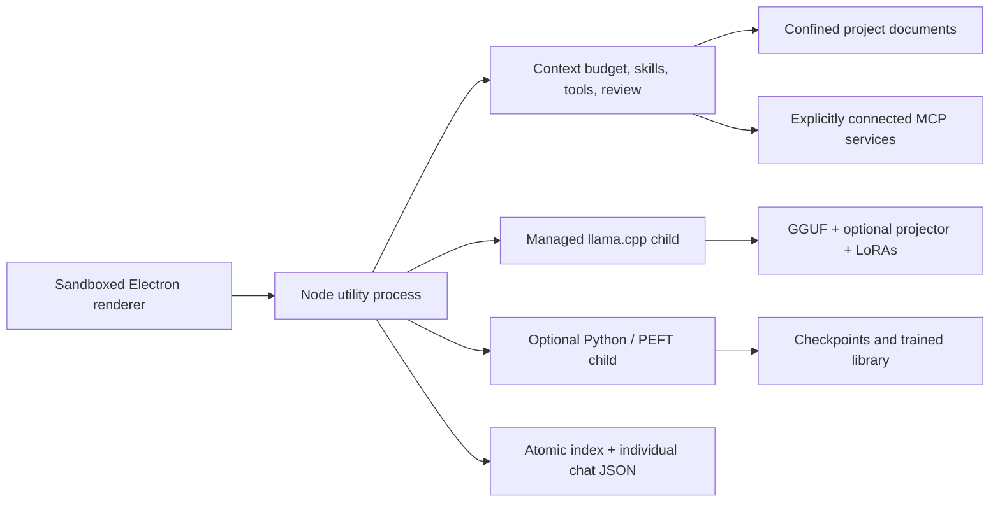

# Forge architecture and release checklist

## Implemented architecture

The desktop main process owns the window, tray and native dialogs. A backend process owns filesystem/API/integration work. Native model and Python workers are separate cancellable processes. The renderer receives session summaries and lazily fetches the selected chat. No model binary, personal chat, dataset or checkpoint is packaged.

## Verification

| Check | Evidence / scope |
| --- | --- |
| Backend tests | Filesystem boundaries, stale writes, auth, cancellation, persistence/migration, API streaming, MCP, downloads, settings, formats and skill resources |
| Desktop smoke | Native window, navigation, editing and saving; feature smoke covers themes, settings, skills, MCP, remote/API, voice, session operations, close/reopen and restart |
| Actual Gemma inference | CUDA streamed load, UI responsiveness timer, real tool call, approved write and enabled skill instruction |
| Runtime modes | Small real GGUF: CPU zero offload, GPU all layers, hybrid partial offload confirmed by runtime logs |
| Training | Tiny real causal model LoRA updates, checkpoint pause, resume, cancel and resume to completed export |
| Adapter stacking | Tiny Llama base + trained adapter converted using official converter; two adapters stacked with scales, then changed/removed |
| Voice | Actual local Whisper WAV transcription; physical microphone/OS permissions remain device-specific |
| Vision | `scripts/smoke-vision.mjs` loads the actual Gemma/projector pair and checks a deterministic image; requires sufficient free RAM/VRAM |
| Packaging | Packaged Windows launch and embedded resources; native macOS/Linux CI builds require their runners |

Hardware scripts use local test assets and write results to ignored `test-artifacts/`. Run heavy inference and training sequentially on memory-limited development machines. Do not turn a refused memory preflight into a passing inference claim.

## Release process

1. Run `npm ci`, `npm run check`, `npm test` and relevant native/hardware smoke checks.
2. Build the Windows installer and launch the packaged app. Check PDF extraction, settings and embedded resources from the archive.
3. Commit only source, the lockfile, icons and documentation. Inspect ignored files; exclude `.data`, models, runtime binaries, projects, credentials and `dist`.
4. Push main to `https://github.com/SinghAbhinav04/Forge.git`; inspect all six package jobs.
5. Tag the matching package version (`v0.2.5`). The tag workflow publishes a GitHub release only after all platform packages pass their checks and build. Windows x64 also runs the Chat/Workspace and background composer GUI regression checks.
6. Check package inventory/checksums. Verify installation, search integration, tray quit, persistence and model operation on actual target systems before claiming native feature certification.

Windows unsigned NSIS, macOS unsigned DMG/ZIP, and Linux AppImage/deb are configured. Signing certificates, Apple notarization, auto-update delivery, rich Word/PDF editing/export, OCR and a built-in terminal/web browser remain future work. Training is causal text LoRA; generic vision/audio training and direct GGUF training are not implemented.
